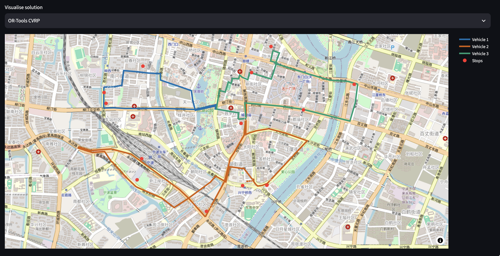

# LogiRoute

**[Live Demo](https://logiroute-jixuanliu.streamlit.app/) | [Source Code](https://github.com/jixuanliu21/LogiRoute)**

A vehicle routing application built with Python, OR-Tools, and Streamlit. It solves capacity-constrained delivery routing problems (CVRP) and compares different approaches to route planning.

The application supports both synthetic delivery scenarios and road networks obtained from OpenStreetMap.

## Demo



## Features

- **Route optimisation:** Nearest Neighbour, 2-opt, and Google OR-Tools for capacity-constrained vehicle routing.
- **Road networks:** OSMnx and NetworkX for shortest-path calculations on real roads, with a sample scenario in Ningbo, China.
- **Travel-time estimation:** An optional PyTorch model that estimates trip durations and uses them as routing costs.
- **Interactive interface:** Upload delivery orders, configure vehicles, visualise routes, and export assignments.
- **Evaluation:** Compare algorithms by route distance, runtime, and feasibility across reproducible test scenarios.

## Tech Stack

Python, OR-Tools, PyTorch, OSMnx, NetworkX, Streamlit, pandas, pytest

## Getting Started

Python 3.11–3.13 is recommended.

```bash
git clone https://github.com/jixuanliu21/LogiRoute.git
cd LogiRoute

python3 -m venv .venv
source .venv/bin/activate
pip install -r requirements-advanced.txt

streamlit run app.py
```

Open the local URL shown in the terminal.

To run the tests and benchmarks:

```bash
python -m pytest -q
python -m experiments.benchmark
```

## Notes

- The road-network module uses real OpenStreetMap road geometry and distances, but does not include live traffic conditions.
- The default PyTorch model is trained on synthetic trip-duration data. It demonstrates how travel-time predictions can be integrated into route optimisation, rather than providing validated traffic forecasts.
- The benchmark uses synthetic delivery scenarios. OR-Tools runs with a configurable time limit and does not guarantee a globally optimal solution.

The current implementation assumes a single depot and vehicles with identical capacity. Delivery time windows and real-time dispatching are not supported.
